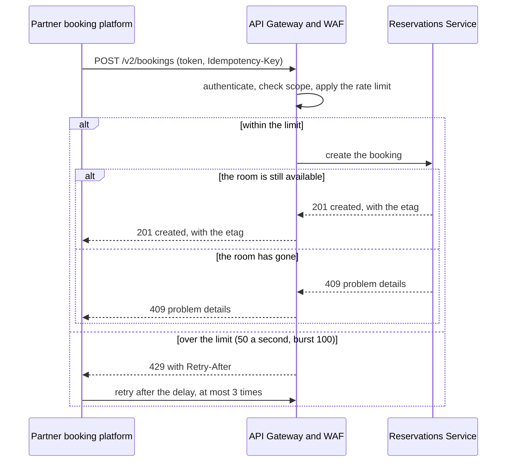

# Partner room availability and booking API

<!-- WORKED EXAMPLE (DRAFT). A fictional hotel group, following the int-api-external pattern.
     Organisations, numbers and contacts are illustrative. -->

## Purpose

Lets online travel agencies and metasearch partners check room availability and create, amend and
cancel bookings in real time. Partner channels deliver about 40% of room nights; if this API stops,
those channels show rooms as unavailable and bookings move to competitors within minutes.

## Parties and responsibilities

| Party | System | Responsible for |
|---|---|---|
| Provider | Reservations Service | Building and running the API; availability and booking logic; the OpenAPI specification |
| Intermediary | API Gateway and WAF (Platform Edge team) | TLS termination, partner authentication, rate limits, WAF rules, gateway logs |
| Consumer | Each partner's booking platform | Calling within limits; retrying as specified; keeping credentials secret |
| Coordinator | Partner Integrations team | Partner onboarding, credential issue, change notices |

## Interaction

- Pattern: `int-api-external`, inbound flow only (the outbound flow in the pattern is not used here).
- Direction and trigger: partner → provider; triggered by a traveller searching or booking on the partner's site.
- Volume: typical 120 requests/s across all partners; peak 900 requests/s (sale events); bookings are about 2% of calls.
- Ordering: not required between requests; amendments to one booking are serialised by the booking's `etag` (see Error handling).

## Interaction flows

Creating a booking, with the two failures a partner must handle.



1. The partner calls `POST /v2/bookings` with an access token and a new `Idempotency-Key`.
2. The gateway checks the token and the `bookings:write` scope, and applies the partner's rate limit.
3. Within the limit, the Reservations Service creates the booking and returns `201` with the booking and its `etag`; if the room is no longer available it returns `409`.
4. Over the limit, the gateway returns `429` with `Retry-After`. The partner waits that long and retries at most 3 times, with the same `Idempotency-Key`.

## Interface specification

- OpenAPI 3.1 `booking-api/v2/openapi.yaml` v2.1.0 — availability search, booking create, amend, cancel, retrieve. The authoritative copy is the developer portal; the repository copy is generated from it.
- Design standard: the organisation's API design standard, aligned with the Australian National API Design Standards (resource naming, error format, versioning).

## Examples

Creating a booking (request, then response):

```http
POST /v2/bookings HTTP/1.1
Authorization: Bearer <access token>
Idempotency-Key: 3f1c9a52-8d44-4c1e-9b7e-2a6d5e0f7c11
Content-Type: application/json

{"propertyId": "P-0042", "roomTypeId": "KING-SEA", "ratePlanId": "FLEX", "checkIn": "2026-11-02", "checkOut": "2026-11-05", "guest": {"name": "Alex Example", "email": "alex@example.org"}}
```

```http
HTTP/1.1 201 Created
ETag: "1"
traceparent: 00-0af7651916cd43dd8448eb211c80319c-b9c7c989f97918e1-01
RateLimit-Limit: 50
RateLimit-Remaining: 49
RateLimit-Reset: 1
Content-Type: application/json

{"bookingId": "B-2026-118204", "status": "confirmed", "total": {"amount": "1260.00", "currency": "AUD"}}
```

The main error, a room that has gone:

```http
HTTP/1.1 409 Conflict
traceparent: 00-5c8e1f3a7b9d4e2f8a6c0b1d3e5f7a92-4e2f7a1b9c3d5e60-01
RateLimit-Limit: 50
RateLimit-Remaining: 48
RateLimit-Reset: 1
Content-Type: application/problem+json

{"type": "https://developer.example.org/problems/room-unavailable", "title": "Room no longer available", "status": 409, "detail": "KING-SEA at P-0042 is sold out for 2026-11-03."}
```

## Environments and onboarding

- Environments: a partner sandbox at `https://sandbox.developer.example.org/v2` with fixed test properties and no real bookings; production at `https://api.example.org/v2`.
- Test data or sandbox: the sandbox returns the examples above for the test properties; it does not simulate rate limiting or `503`.
- Access: a partner asks Partner Integrations through the developer portal; approval takes 5 business days and ends with a client id and secret for the sandbox.
- First call: `GET /v2/properties/P-0042/availability?from=2026-11-02&to=2026-11-05` against the sandbox returns `200`.

## Data

- Entities: property, room type, rate plan, availability, booking, guest.
- Classification: OFFICIAL:Sensitive, driven by guest name, email, phone and loyalty number on booking resources. Availability and rate data alone is OFFICIAL.
- Personal information: guest name, email, phone and loyalty number, shared under the partner agreement to fulfil the traveller's booking.
- Residency: provider data is hosted in Australian regions only.
- Retention: provider keeps bookings 7 years (financial records); partners' retention is governed by their agreement and is not set by this ICR.

## Security

- Authentication: OAuth 2.0 client credentials per partner; access tokens valid 15 minutes.
- Credential issue and rotation: client secrets issued by Partner Integrations through the developer portal; rotated every 90 days with a 7-day overlap.
- Authorisation: scopes `availability:read`, `bookings:write`; a partner can read and amend only bookings it created.
- Transport: HTTPS, TLS 1.2 minimum (TLS 1.3 preferred).
- Network path: public internet to the WAF and API Gateway in the perimeter subnet; the Reservations Service is in a private subnet with no inbound internet route.
- Pattern controls inherited: all security controls of [int-api-external](https://itarchitecturepatterns.net/patterns/int-api-external). Additional: WAF bot-management rules for availability scraping.

## Service levels

- Availability: 99.9% per calendar month, measured at the API Gateway (successful responses ÷ valid requests, excluding 4xx).
- Latency: availability search p95 ≤ 400 ms; booking create p95 ≤ 1,200 ms; measured at the API Gateway.
- Throughput: 50 requests/s per partner (burst 100); beyond it the gateway returns HTTP 429 with `Retry-After`.
- How a partner learns its limit and its use: every response carries `RateLimit-Limit`, `RateLimit-Remaining` and `RateLimit-Reset` headers, and a `429` body names the limit that was exceeded.
- Freshness: availability reflects inventory changes within 30 s.
- Recovery for the integration: time 1 hour (gateway failover to the second region); point none for bookings (a booking is replicated before the `201` is returned).
- Support hours for these objectives: 24×7.

## Error handling

- Errors: RFC 9457 problem details. `400` invalid request; `401` / `403` authentication or scope; `404` unknown booking; `409` room no longer available; `412` a stale `etag` (the `If-Match` precondition failed); `410` a retired major version (`/v1/`); `429` rate limited; `503` provider degraded.
- Timeouts: the gateway times out upstream calls at 5 s; partners SHOULD time out at 8 s.
- Retries: partners MAY retry `429` and `503` only, honouring `Retry-After`, at most 3 times with exponential backoff (1 s, 2 s, 4 s). Never retry `4xx` other than `429`.
- Idempotency: booking create requires an `Idempotency-Key` header (UUID); the provider returns the original response for a repeated key within 24 hours. Amendments require `If-Match` with the booking's `etag`.
- Failed requests: not queued by the provider; synchronous failures are returned to the partner.
- Recovery after an outage: partners re-run availability searches; bookings created with an idempotency key are safe to resubmit.

## Change and versioning

- Interface versioning: major version in the path (`/v2/`); minor and patch changes are additive.
- Breaking change means: removing or renaming a field, endpoint or enum value; changing a field's type or meaning; tightening validation.
- Notice before a breaking change or deprecation: 6 months, by developer-portal notice and email to each partner's registered contact; the old major version runs for 6 months after the new one is live.
- What each consumer relies on: the partners rely on `bookingId`, `status`, `total` and the `etag` on every booking response, on the problem `type` URIs for `409`, and on the three `RateLimit-*` headers; the partner sandbox runs a contract test for each.
- Changing this ICR: proposed by Guest Platforms; approved by Guest Platforms, Platform Edge and Partner Integrations.

## Observability

- Correlation identifier: `traceparent` (W3C Trace Context), created at the gateway if absent and returned in responses.
- Logs: the gateway logs partner id, route, status and latency — no request bodies. The provider logs booking ids, never guest contact details.
- Metrics and alerts: error rate > 2% for 5 min (page Guest Platforms); p95 latency over target for 10 min (page Guest Platforms); a single partner receiving 429s > 20% for 15 min (notify Partner Integrations).

## Support and escalation

| Party | Contact | Hours | Escalation |
|---|---|---|---|
| Guest Platforms | guest-platforms@example.org, on-call pager | 24×7 | Head of Guest Platforms |
| Platform Edge | platform-edge@example.org | 24×7 | Head of Cloud Platforms |
| Partner Integrations | partner-integrations@example.org | Business hours AEST | Partnerships Manager |

Severity levels and response targets: Sev 1 (API unavailable or bookings failing) — respond 15 min, update hourly; Sev 2 (degraded) — respond 1 hour; Sev 3 — next business day.

## Acceptance criteria

1. A request with no token, or a token without the needed scope, receives 401 or 403 and never reaches the Reservations Service. Proved by: the gateway authorisation test in CI.
2. Availability search p95 ≤ 400 ms and booking create p95 ≤ 1,200 ms under 900 requests/s for 15 minutes in the load-test environment. Proved by: the load test, run before each release.
3. A partner exceeding 100 requests in one second receives HTTP 429 with a `Retry-After` header. Proved by: the rate-limit test in CI.
4. Submitting the same booking create twice with one `Idempotency-Key` creates one booking, and both responses are identical. Proved by: a contract test that submits it twice.
5. An amendment with a stale `If-Match` receives 412 and does not change the booking. Proved by: an API test with a stale `etag`.
6. Every response carries a `traceparent`, and the same trace id appears in the gateway and provider logs. Proved by: a trace test that reads both logs.
7. No log line in the gateway or provider contains a guest email address or phone number. Proved by: the automated log scan.
8. A request for `/v1/` receives 410 Gone with a problem-details body naming the replacement version. Proved by: a smoke test after each deploy.
9. Every request and response shown in Examples is valid against the OpenAPI specification. Proved by: the OpenAPI validation step in CI.

## Related records

- Pattern: [int-api-external](https://itarchitecturepatterns.net/patterns/int-api-external)
- Decisions: ADR-0012 (OAuth 2.0 client credentials over mTLS for partners), ADR-0019 (idempotency keys for booking create)
