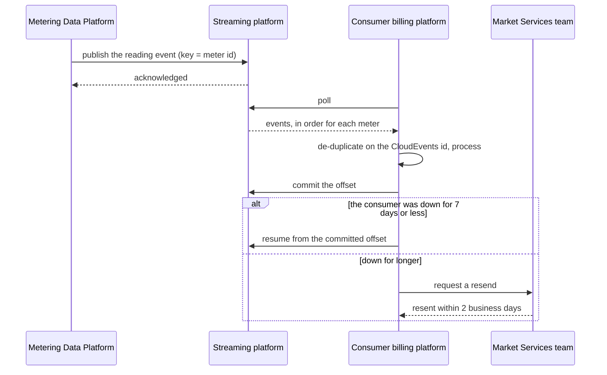

# Interval meter reading event stream

<!-- WORKED EXAMPLE (DRAFT). A fictional electricity distributor, following the int-esp-cloud
     pattern. Organisations, numbers and contacts are illustrative. -->

## Purpose

Delivers validated interval meter readings from the distributor to each retail supplier and the
settlement agency, so customers are billed on actual consumption and the market settles on time. If
the stream stops, bills fall back to estimates and settlement misses its daily cut-off.

## Parties and responsibilities

| Party | System | Responsible for |
|---|---|---|
| Provider | Metering Data Platform | Validating readings; publishing events; the AsyncAPI specification and schemas |
| Intermediary | Managed event streaming platform (Integration Platform team) | Topics, access control, schema registry, retention, platform availability |
| Consumer | Each retail supplier's billing platform | Consuming within retention; de-duplicating; managing its own offsets |
| Consumer | Settlement agency | As above, over a dedicated private connection |
| Coordinator | Market Services team | Consumer onboarding, credentials, change notices |

## Interaction

- Pattern: `int-esp-cloud`. Deviation: the settlement agency connects over a dedicated private link rather than through the internet-facing WAF, as the pattern allows for high-volume parties.
- Direction and trigger: provider → consumers; an event is published when a meter's 30-minute interval reading passes validation.
- Volume: about 2.1 million events per day; peak 180 events/s at the 00:30 batch close.
- Ordering: required per meter; events are keyed by meter identifier, so each meter's readings stay in one partition and arrive in order.

## Interaction flows

Publishing a reading, and a consumer that falls behind.



1. A 30-minute interval reading passes validation; the platform publishes one event, keyed by meter id, so each meter's readings stay in one partition and in order.
2. A consumer polls, de-duplicates on the CloudEvents `id`, processes the event and then commits its offset.
3. A consumer that was down resumes from its committed offset if that is within the 7-day retention window.
4. Beyond 7 days, the consumer asks Market Services for a resend, fulfilled within 2 business days.

## Interface specification

- AsyncAPI 3.0 `meter-readings/asyncapi.yaml` v1.4.0 — channels `readings.interval.v1.<region>` and message schema. The authoritative copy is the developer portal.
- Events use the CloudEvents 1.0 envelope; the `data` payload is Protobuf, registered in the schema registry under `readings.interval.v1`.
- Design standard: the organisation's event design guidelines (past-tense event names, immutable events, one event type per topic).

## Examples

One reading as a CloudEvent in the JSON format. The `data` is Protobuf, so it travels as `data_base64`; it was built from the decoded fields below with the field numbers 1 to 5 in that order (meterId, intervalStart, intervalEnd, kWh as a double, quality).

```json
{
  "specversion": "1.0",
  "id": "9b2e5c1a-6f0d-4b3e-8a41-0c7d52e9f3aa",
  "source": "//metering.example.org/regions/vic",
  "type": "org.example.metering.interval-reading-validated.v1",
  "time": "2026-09-18T00:30:04Z",
  "datacontenttype": "application/protobuf",
  "traceparent": "00-4bf92f3577b34da6a3ce929d0e0e4736-00f067aa0ba902b7-01",
  "data_base64": "Cg5OTUktNjAwMTIzNDU2NxIUMjAyNi0wOS0xOFQwMDowMDowMFoaFDIwMjYtMDktMThUMDA6MzA6MDBaIZHtfD81Xto/KgZBQ1RVQUw="
}
```

The `data` decoded against the registered schema:

```json
{"meterId": "NMI-6001234567", "intervalStart": "2026-09-18T00:00:00Z", "intervalEnd": "2026-09-18T00:30:00Z", "kWh": 0.412, "quality": "ACTUAL"}
```

The main error, a duplicate delivery (the delivery is at least once): the same `id` arrives twice, and the consumer processes it once.

```text
offset 88123  id 9b2e5c1a-6f0d-4b3e-8a41-0c7d52e9f3aa  processed
offset 88391  id 9b2e5c1a-6f0d-4b3e-8a41-0c7d52e9f3aa  duplicate, skipped
```

## Data

- Entities: meter, interval reading (start, end, kWh, quality flag).
- Classification: Commercial-in-confidence.
- Personal information: meter identifier with consumption can identify a household's activity, so it is treated as personal information and shared only with the supplier responsible for that meter (see Security).
- Residency: all platform data in Australian regions.
- Retention: 7 days on the stream (the consumer replay window); the provider keeps readings 7 years; consumers per their own obligations.
- Data quality: a reading is published only after validation; there is at most one reading for a meter and interval; `quality` is one of `ACTUAL`, `ESTIMATED` or `SUBSTITUTED`; a breach of any of these is a provider defect, and consumers are told on the portal within 1 business day.

## Security

- Authentication: mTLS client certificates per consumer, plus OAuth 2.0 client credentials for the schema registry.
- Credential issue and rotation: certificates issued by Market Services, valid 12 months, renewed 30 days before expiry.
- Authorisation: each supplier may read only the regional topics and consumer groups assigned to it; the settlement agency reads all regions; only the Metering Data Platform may write.
- Transport: Kafka protocol over TLS 1.2 minimum.
- Network path: suppliers over the public internet through the perimeter (IP allow-list per supplier); the settlement agency over a dedicated private connection.
- Pattern controls inherited: all security controls of [int-esp-cloud](https://itarchitecturepatterns.net/patterns/int-esp-cloud).

## Service levels

- Availability: streaming platform 99.95% per month, measured by synthetic produce and consume every minute.
- Freshness: 95% of readings published within 5 minutes of the interval closing; 99.9% within 30 minutes.
- Throughput: platform sized for 3× peak (540 events/s).
- How a consumer learns its position: the portal shows each consumer group's lag per region, refreshed every minute; there is no per-consumer limit, only the 6-hour lag obligation below.
- Consumer obligation: consumers keep lag below 6 hours; beyond 7 days they lose data to retention.
- Recovery for the integration: time 30 minutes (failover to the standby cluster); point none for published events (an event is replicated before it is acknowledged).
- Support hours for these objectives: 24×7 for availability; freshness measured and reported daily.

## Error handling

- Delivery: at least once. Consumers MUST de-duplicate on the CloudEvents `id`.
- Invalid readings: never published; failed validation is handled inside the provider and is out of scope here.
- Schema: the registry rejects any schema version that is not backward-transitively compatible, so a publish with an incompatible schema fails at the provider.
- Consumer processing failures: the consumer's own responsibility. It MUST NOT commit an offset for an event it has not processed or parked in its own dead-letter store.
- Recovery after an outage: a consumer resumes from its committed offset within the 7-day window. Beyond it, the consumer requests a resend from Market Services, fulfilled within 2 business days.

## Change and versioning

- Interface versioning: schema registry compatibility mode `BACKWARD_TRANSITIVE`; a breaking change is a new event type on a new `.v2` channel.
- Breaking change means: removing or renaming a field, or changing a field's meaning, unit or type.
- Notice before a breaking change or deprecation: 90 days, by portal notice and email; `.v1` and `.v2` run in parallel for at least 90 days.
- What each consumer relies on: the suppliers rely on the CloudEvents attributes, `meterId`, `intervalStart`, `intervalEnd`, `kWh` and `quality`, on per-meter ordering, and on the 7-day replay window; the settlement agency also relies on the `.v1` channel names. Each runs a reference-consumer test against the test channel.
- Changing this ICR: proposed by Network Metering; approved by Network Metering, Integration Platform and Market Services.

## Observability

- Correlation identifier: the CloudEvents `id`, with `traceparent` as a CloudEvents extension attribute.
- Logs: the provider logs publish results by event id; no consumption values are logged.
- Metrics and alerts: publish freshness p95 > 5 min for 15 min (page Network Metering); per-consumer lag > 6 hours (email Market Services and the consumer's contact); synthetic check failure for 3 minutes (page Integration Platform).

## Support and escalation

| Party | Contact | Hours | Escalation |
|---|---|---|---|
| Network Metering | metering-platform@example.org, on-call | 24×7 | Head of Metering |
| Integration Platform | integration-platform@example.org, on-call | 24×7 | Head of Cloud Platforms |
| Market Services | market-services@example.org | Business hours AEST | Market Operations Manager |

Severity levels and response targets: Sev 1 (no events published for 15 minutes) — respond 15 min; Sev 2 (freshness objective missed) — respond 1 hour; Sev 3 — next business day.

## Acceptance criteria

1. A consumer certificate for one supplier cannot read another supplier's regional topic. Proved by: the authorisation test per supplier in CI.
2. Registering a schema that removes a field is rejected by the registry. Proved by: the registry compatibility test.
3. Replaying the same event twice results in one stored reading at a reference consumer that de-duplicates on CloudEvents `id`. Proved by: the reference-consumer test.
4. Readings for one meter are consumed in interval order across a partition rebalance. Proved by: the rebalance test.
5. Synthetic publish-to-consume latency is under 60 s at p95 over 24 hours. Proved by: the synthetic probe, which alerts when it is breached.
6. A consumer offline for 72 hours resumes from its committed offset and receives every event it missed. Proved by: the monthly outage drill.
7. Each event carries the CloudEvents `id`, `source`, `type`, `time` and a `traceparent` extension. Proved by: a schema check on a sampled event each hour.
8. The example event in Examples is valid CloudEvents JSON and its `data` decodes against the registered schema. Proved by: the validation step in CI.

## Related records

- Pattern: [int-esp-cloud](https://itarchitecturepatterns.net/patterns/int-esp-cloud)
- Decisions: ADR-0031 (key by meter identifier for per-meter ordering)
