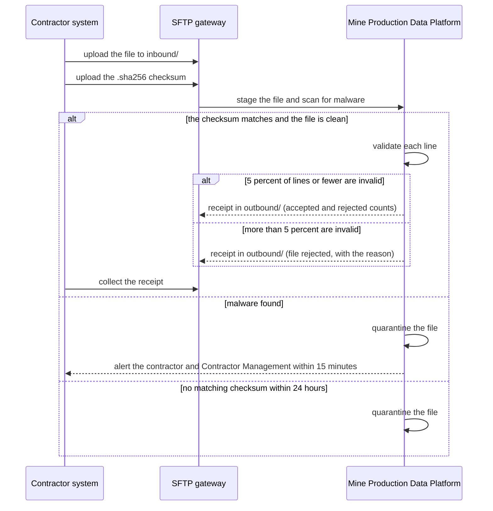

# Contractor nightly production files

<!-- WORKED EXAMPLE (DRAFT). A fictional open-pit mining operator, following the
     int-filetransfer-external pattern. Organisations, numbers and contacts are illustrative. -->

## Purpose

Collects each contractor's nightly production and equipment files (tonnes moved, blast logs, fleet
utilisation) so the operator can reconcile contractor claims and report production. It returns a
processing receipt to each contractor. If files stop arriving, contractor payments and daily
production reporting are delayed.

## Parties and responsibilities

| Party | System | Responsible for |
|---|---|---|
| Provider | Mine Production Data Platform | Receiving, scanning, validating and loading files; receipts; the file specification |
| Intermediary | Managed SFTP gateway (Platform Edge team) | Contractor accounts, keys, the perimeter, transfer logs |
| Consumer (sender) | Each contractor's system | Producing valid files on schedule; naming them correctly; resending on rejection |
| Coordinator | Contractor Management team | Onboarding contractors, key exchange, change notices |

## Interaction

- Pattern: `int-filetransfer-external`, both flows: the inbound production file, and the outbound receipt.
- Direction and trigger: the contractor uploads after each shift closes; the provider returns a receipt when processing finishes.
- Volume: about 40 contractors; one file per contractor per shift (two shifts a day); files 1–60 MB; about 80 files per day.
- Ordering: files for one contractor are processed in `shift-date` then `shift` order; a late file for an earlier shift is accepted and processed out of order.

## Interaction flows

A contractor's nightly file, and the ways it can be turned back.



1. After a shift closes, the contractor uploads the file and then its `.sha256` to `inbound/`, within 4 hours.
2. The gateway stages the file and the platform scans it; it is processed only once the checksum is present and matches.
3. The platform validates each line. With 5% or fewer invalid, valid lines load and the receipt lists the rest; with more, the whole file is rejected and the receipt gives the reason.
4. The platform places the receipt in `outbound/` within 60 minutes. The contractor collects it and, if needed, resends with the next sequence number.
5. A file the scan finds infected is quarantined, never processed, and the contractor and Contractor Management are alerted within 15 minutes.
6. A file with no matching checksum after 24 hours is quarantined.

## Interface specification

- File format: UTF-8 JSON Lines, one production record per line, each validated against `production-record.schema.json` v1.2.0.
- File naming: `<contractorId>_<site>_<yyyymmdd>_<shift>_<seq>.jsonl`, for example `C017_NORTHPIT_20260918_N_01.jsonl`.
- Integrity: each file is accompanied by `<name>.sha256` containing its SHA-256 checksum.
- Receipt: `<name>.receipt.json` placed in the contractor's `outbound/` folder, with record counts accepted and rejected and a reason per rejected line.
- Design standard: the organisation's partner file exchange standard.

## Examples

A file name and its first lines (JSON Lines):

```text
C017_NORTHPIT_20260918_N_01.jsonl
{"shiftDate": "2026-09-18", "shift": "N", "equipmentId": "HT-204", "material": "waste", "loadTonnes": 218.4, "loadedAt": "2026-09-18T20:42:00+08:00"}
{"shiftDate": "2026-09-18", "shift": "N", "equipmentId": "HT-207", "material": "ore", "loadTonnes": 221.9, "loadedAt": "2026-09-18T20:47:00+08:00"}
```

The main error, a receipt for a file with rejected lines (`C017_NORTHPIT_20260918_N_01.receipt.json`):

```json
{
  "file": "C017_NORTHPIT_20260918_N_01.jsonl",
  "status": "accepted-with-rejections",
  "accepted": 1184,
  "rejected": [{"line": 311, "reason": "loadTonnes must be a positive number"}]
}
```

## Data

- Entities: shift, equipment unit, load, blast, survey point.
- Classification: Commercial-in-confidence (contractual rates are derivable from the volumes).
- Personal information: none. Operator identifiers are contractor employee numbers and are removed at source by agreement.
- Residency: Australian regions only.
- Retention: raw files in object storage 90 days, then archived for 7 years; receipts 2 years.
- Data quality: each line is validated against `production-record.schema.json` (types, ranges, required fields); within a file a `loadedAt` is never in the future and the pair `equipmentId` and `loadedAt` is unique; a file with more than 5% failing lines is rejected whole, and the contractor is told why by the receipt (Contractor Management sees it in the daily summary).

## Security

- Authentication: SSH key pairs per contractor, Ed25519, generated by the contractor; the public key is exchanged through Contractor Management.
- Credential rotation: keys rotated every 12 months and on contractor staff changes.
- Authorisation: each contractor account is chrooted to its own `inbound/` and `outbound/` folders.
- Transport: SFTP only. FTP, FTPS and SCP are disabled.
- Network path: public internet to the SFTP gateway in the perimeter, with an IP allow-list per contractor. Files are staged to encrypted object storage in a private subnet; no internal system is reachable from the gateway.
- Pattern controls inherited: all security controls of [int-filetransfer-external](https://itarchitecturepatterns.net/patterns/int-filetransfer-external), including malware scanning before any processing.

## Service levels

- Availability: SFTP gateway 99.5% per month, measured by a synthetic login and upload every 5 minutes.
- Processing time: a receipt within 60 minutes of a complete upload (file and checksum present) for files up to 60 MB.
- Submission deadline (contractor obligation): within 4 hours of shift close.
- How a contractor learns its status: every upload gets a receipt in `outbound/`, and a daily summary lists late and missing shifts; each contractor may hold 5 concurrent sessions and a sixth is refused with a clear message.
- Recovery for the integration: time 4 hours (the gateway is restored in the second availability zone); point none for received files (a file is stored before the upload is acknowledged).
- Support hours for these objectives: 24×7 for the gateway; processing issues business hours AWST.

## Error handling

- Incomplete upload: a file is processed only once its `.sha256` is present and matches; otherwise it is ignored for 24 hours, then quarantined.
- Malware: an infected file is quarantined, never processed, and Contractor Management and the contractor are alerted within 15 minutes.
- Invalid file (bad name, bad JSON, schema failure over 5% of lines): rejected as a whole; the receipt gives the reason; the contractor corrects and resends with the next `<seq>`.
- Invalid lines (5% or fewer): valid lines are loaded; rejected lines are listed in the receipt for resubmission.
- Idempotency: a file whose name and checksum match one already processed is acknowledged as a duplicate and not reloaded.
- Retries: the provider does not pull; contractors resend. The gateway accepts resends at any time within 30 days of the shift date.
- Recovery after an outage: files uploaded during a processing outage are processed in arrival order when it ends; receipts follow.

## Change and versioning

- Interface versioning: the schema version is in the `ref` path (`/v1/`); additive fields are minor versions; the processor accepts both minor versions during a change.
- Breaking change means: removing or renaming a field; changing units or meaning; changing the naming convention.
- Notice before a breaking change: 120 days, through Contractor Management, with a test folder available for 60 of those days.
- What each consumer relies on: the contractors rely on the file naming convention, the `.sha256` rule, the layout of the receipt and the 5% threshold; the test folder holds a sample of each.
- Changing this ICR: proposed by Operations Technology; approved by Operations Technology, Platform Edge and Contractor Management.

## Observability

- Correlation identifier: the file name, used as the correlation id across gateway, scan, load and receipt logs.
- Logs: the gateway logs logins, uploads and downloads; the processor logs per-file counts. No record contents are logged.
- Metrics and alerts: no file from an active contractor within 6 hours of shift close (email Contractor Management); quarantine event (immediate alert); receipt not produced within 60 minutes (page Operations Technology).

## Support and escalation

| Party | Contact | Hours | Escalation |
|---|---|---|---|
| Operations Technology | ot-integration@example.org | Business hours AWST, on-call for Sev 1 | OT Manager |
| Platform Edge | platform-edge@example.org | 24×7 | Head of Cloud Platforms |
| Contractor Management | contractor-management@example.org | Business hours AWST | Contracts Manager |

Severity levels and response targets: Sev 1 (gateway down, or no files processed for 4 hours) — respond 30 min; Sev 2 (single contractor blocked) — respond 2 hours; Sev 3 — next business day.

## Acceptance criteria

1. An upload by a contractor key lands only in that contractor's `inbound/` folder; access to another contractor's folder is refused. Proved by: the gateway isolation test in CI.
2. FTP, FTPS and SCP connections to the gateway are refused. Proved by: a port and protocol check after each deploy.
3. A file without a matching `.sha256` is not processed. Proved by: an integration test.
4. The EICAR test file is quarantined, never reaches the processor, and triggers the alert within 15 minutes. Proved by: the weekly synthetic malware upload.
5. A file with 3% invalid lines loads the valid lines and lists exactly the invalid ones in its receipt; a file with 10% invalid lines is rejected whole. Proved by: two fixture files in CI.
6. Re-uploading an already processed file (same name and checksum) produces a duplicate receipt and no second load. Proved by: an integration test.
7. A valid 60 MB file produces its receipt within 60 minutes. Proved by: the nightly synthetic upload.
8. Every log line for a file carries the file name as its correlation id. Proved by: the automated log scan.
9. The sample lines and the receipt in Examples validate against `production-record.schema.json` and the receipt format. Proved by: the schema check in CI.

## Related records

- Pattern: [int-filetransfer-external](https://itarchitecturepatterns.net/patterns/int-filetransfer-external)
- Decisions: ADR-0044 (JSON Lines over CSV for contractor files)
