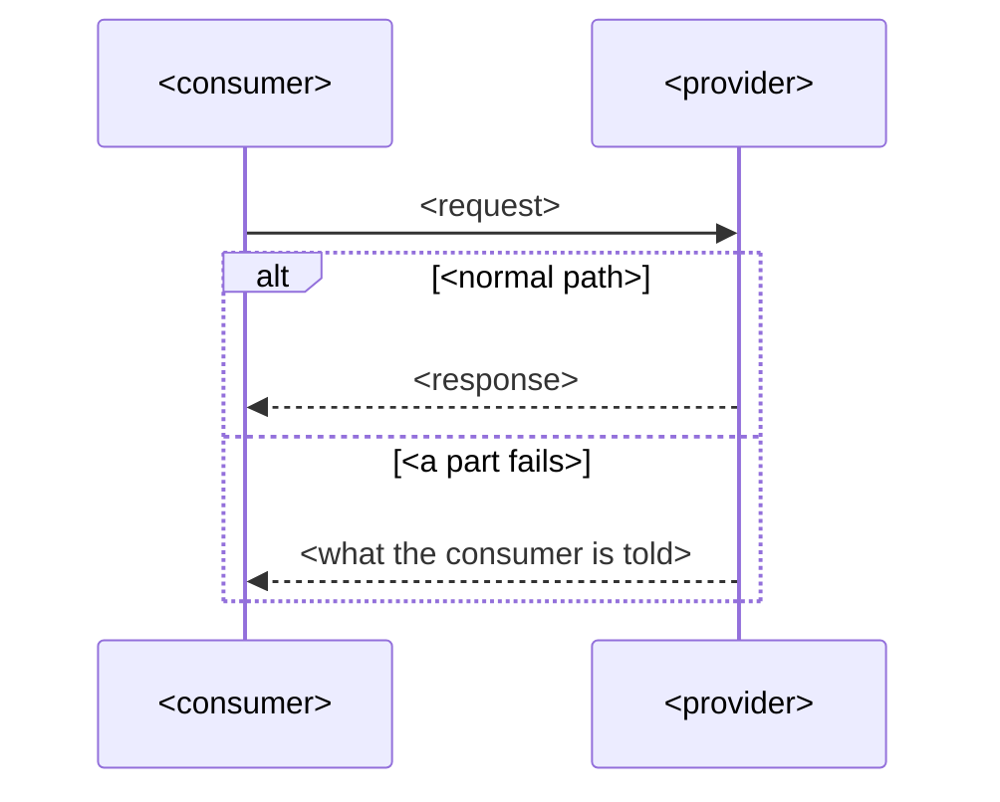

# <title>

<!-- DRAFT template, ICR v0.2. Write each section as short, testable statements. Required sections
must be present and non-empty; write "Not applicable: <reason>" rather than deleting one. -->

## Purpose

<Why this integration exists in business terms, and what breaks if it stops. 2–4 sentences.>

## Parties and responsibilities

| Party | System | Responsible for |
|---|---|---|
| Provider | | |
| Consumer | | |

## Interaction

- Pattern: <pattern>, <any deliberate deviation and why>
- Direction and trigger:
- Volume: typical <n per unit>, peak <n per unit>
- Ordering:

## Interaction flows

<!-- Draw each flow as a Mermaid sequence diagram with an accTitle and an accDescr, then say the same in numbered steps. One participant per party above; show the main failure as an alt branch. -->



1. <step, naming the party and the message>
2.

## Interface specification

- <type> <ref> v<version> — <what it covers>; authoritative copy: <where>
- Design standard followed:

## Examples

<!-- Realistic, valid against the specification above, and free of real personal data. -->

The main exchange:

```
<request and response, event with its envelope, or file excerpt>
```

The main error, as the consumer receives it:

```
<error>
```

<!-- OPTIONAL. Remove this section if you don't need it. -->
## Environments and onboarding

- Environments: <test and production: where, and how they differ>
- Test data or sandbox: <what exists, and what it does not simulate>
- Access: <how a new consumer asks, who approves, how long it takes>
- First call: <the smallest exchange that shows a new consumer is connected>

## Data

- Entities:
- Classification: <classification>; driven by: <fields>
- Personal information: <none | fields, and the basis for sharing>
- Residency:
- Retention: provider <period>; consumer <period>
- Data quality: <rules for batch-file and stream: completeness, validity, uniqueness; who is told when broken>

## Security

- Authentication:
- Credential issue and rotation:
- Authorisation:
- Transport:
- Network path:
- Pattern controls inherited: <link>; additional controls:

## Service levels

- Availability: <target>, measured at <point>
- Latency: <percentile ≤ value>, measured at <point>
- Throughput: <limit>, beyond it: <behaviour>
- Freshness:
- How a consumer learns its limit and use: <headers or documentation>
- Recovery: time <how long the integration may be down>; point <how much it may lose>
- Support hours for these objectives:

## Error handling

- Errors and their meaning:
- Timeouts:
- Retries: <who, how many, backoff>
- Idempotency:
- Failed messages or files: <where they go, who is alerted>
- Recovery after an outage:

## Change and versioning

- Interface versioning:
- Breaking change means:
- Notice before a breaking change or deprecation: <period>, via <channel>
- What each consumer relies on: <fields, behaviours, timings, or a link to its contract tests>
- Changing this ICR: <who approves>

## Observability

- Correlation identifier:
- Logs:
- Metrics and alerts: <metric, threshold, recipient>

## Support and escalation

| Party | Contact | Hours | Escalation |
|---|---|---|---|

Severity levels and response targets:

## Acceptance criteria

1. <testable statement> — proved by: <test, synthetic check or alert>
2.

## Related records

- Pattern: <link>
- Decisions:

## Open issues

<!-- Remove this section when empty; an ICR with open issues cannot move to "agreed". -->
